<picture>
  <source media="(prefers-color-scheme: dark)" srcset="assets/hero-dark.svg">
  
</picture>

Year 2 **Data Science & AI** undergraduate at **NTU Singapore**, working on agents, evaluation, adversarial robustness and edge inference.

- **Now:** URECA researcher at NTU EEE, profiling Vision-Language-Action model inference on Jetson-class edge GPUs: per-layer latency, memory footprint and KV-cache growth with PyTorch hooks and NVTX.
- Academic Development Policy Executive, 36th NTU Students' Union.
- [LinkedIn](https://www.linkedin.com/in/ethankoksj) · ekok003@e.ntu.edu.sg

## Selected work

<a href="https://github.com/aniketmajee7-pixel/NTUxSTEng_Hackathon"><picture><source media="(prefers-color-scheme: dark)" srcset="assets/trace/hackathon-dark.svg"></picture></a>
<a href="https://github.com/ethankok/til-ai-2026-melanie-minions"><picture><source media="(prefers-color-scheme: dark)" srcset="assets/trace/til-ai-dark.svg"></picture></a>
<a href="https://github.com/ethankok/calorpie-bot"><picture><source media="(prefers-color-scheme: dark)" srcset="assets/trace/calorpie-dark.svg"></picture></a>
<a href="https://github.com/ethankok/sg-carpark-demand"><picture><source media="(prefers-color-scheme: dark)" srcset="assets/trace/carpark-dark.svg"></picture></a>

<b>NTU × ST Engineering Hackathon 2026</b> · 🏆 Champion of 30 teams

 

A Python agent that does 15 minutes of unattended office work on an air-gapped Windows 11 VM (Chrome, OpenOffice Calc, Notepad) and passes as a person in Sysmon and process logs. Pointer motion follows minimum-jerk paths and Fitts' law; typing pauses are lognormal, checked against a 136M-keystroke study. It reads Calc's grid from pixels because Calc exposes nothing to UI Automation. The final run finished in 14:15 at 0.11% CPU and wrote no files of its own.

`Python` `PyAutoGUI` `pywinauto` `pywin32`

<b>DSTA BrainHack TIL-AI 2026</b> · Semifinalist, top 10 of 80+ teams

 

Technical lead of a team of 5, shipping five ML tasks as Dockerised FastAPI services: speech recognition, object detection, retrieval QA, adversarial noise and a Bomberman-style game agent. The game agent is a Dijkstra planner with a confidence-gated PPO consultant and CEM-tuned weights. For QA, a 16-token HotFlip trigger against the white-box answer grader lifted accuracy from 0.683 to 0.951 (with organiser approval).

`Python` `PyTorch` `PPO` `YOLO11` `Docker`

<b>Calorpie bot</b> · Telegram calorie tracker with daily users

 

Send a photo, text or voice note of any meal and Gemini returns a schema-checked estimate. LLM photo estimates are off by about 20% per meal, so each reply shows one number, is easy to correct, and asks a follow-up only when one detail matters. On foods with published values (chain-restaurant and plain foods), estimates average about 4% error. Runs in Docker on an Oracle Always Free VM, tested end to end against a fake Telegram API.

`Python` `Gemini API` `python-telegram-bot` `SQLite` `Docker`

<b>Singapore carpark demand</b> · NTU SC3021 course project

 

Flags parking deserts: hours when an HDB carpark is at least 90% full. From 7.8M carpark and weather records across 4 Data.gov.sg APIs, k-Means found 4 carpark archetypes and a Simpson's Paradox in the weather correlations, and a logistic-regression early-warning model caught 75% of parking-desert hours.

<a href="https://github.com/ethankok/sg-carpark-demand"><picture><source media="(prefers-color-scheme: dark)" srcset="assets/carpark-dark.svg"></picture></a>

`Pandas` `scikit-learn`

Also: [Church Bench](https://github.com/ethankok/church-bench) and [Cute Cat Replacer](https://github.com/ethankok/cute-cat-replacer), two Chrome MV3 extensions.
